# Lab 2 – Deep Learning : Vision par ordinateur (MNIST)

## Objectif
Prendre en main PyTorch et construire des architectures de vision
(CNN, Faster R-CNN, modèles pré-entraînés, Vision Transformer)
en mode GPU sur le dataset MNIST.

## Environnement
- Plateforme : Kaggle(GPU : T4 x2)
- Dataset : [MNIST (Kaggle)](https://www.kaggle.com/datasets/hojjatk/mnist-dataset)

## Partie 1 : Classifieurs CNN
### 1.1 CNN from scratch

**Données** 

MNIST (60 000 images d'entraînement, 10 000 de test, 28×28 en niveaux de gris),
lu depuis les fichiers IDX du dataset Kaggle.

Découpage : 54 000 train / 6 000 validation /
10 000 test (graine = 42). 

Normalisation : moyenne 0.1307, écart-type 0.3081.

**Architecture**

| Couche | Détail | Sortie |
|---|---|---|
| Conv2d + BatchNorm + ReLU | 1→32 filtres, kernel 3×3, stride 1, padding 1 | 32×28×28 |
| MaxPool2d | 2×2 | 32×14×14 |
| Conv2d + BatchNorm + ReLU | 32→64 filtres, kernel 3×3, stride 1, padding 1 | 64×14×14 |
| MaxPool2d | 2×2 | 64×7×7 |
| Flatten + Linear + ReLU | 3136→128 | 128 |
| Dropout | p = 0.3 | 128 |
| Linear | 128→10 | 10 |

Nombre de paramètres : **421 834**.

**Hyperparamètres**

| Paramètre | Valeur |
|---|---|
| Optimiseur | Adam, lr = 1e-3 |
| Régularisation | Dropout 0.3, weight decay 1e-4, BatchNorm |
| Fonction de perte | CrossEntropyLoss |
| Batch size | 128 |
| Époques | 10 |
| Matériel | GPU Tesla T4 (Kaggle) |

**Résultats sur le jeu de test**

| Accuracy | F1-score (macro) | Loss | Temps d'entraînement |
|---|---|---|---|
| 99.04 % | 99.03 % | 0.0289 | 22.6 s |

**Courbes d'apprentissage** 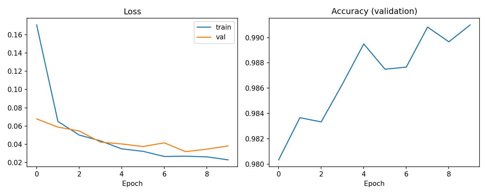

**Matrice de confusion** 

**Analyse**

- **Convergence :** dès la première époque, le modèle atteint 98,03 % d'accuracy en validation. La loss d'entraînement baisse régulièrement (0.1706 → 0.0230) et l'accuracy de validation se stabilise autour de 99 % à partir de l'époque 5 (99,10 % à l'époque 10).
- **Généralisation :** l'écart entre la loss d'entraînement (0.0230) et la loss de validation (0.0382) reste faible. La loss de validation est minimale à l'époque 8 (0.0320) puis remonte légèrement aux époques 9 et 10, signe d'un début de surapprentissage très modéré. Le dropout, le weight decay et la BatchNorm le limitent efficacement. La loss de test (0.0289) est cohérente avec celle de validation.
- **Accuracy et F1 :** les deux valeurs sont quasi identiques (99,04 % et 99,03 %), ce qui est attendu : MNIST est un jeu de données bien équilibré entre les 10 classes, donc aucune classe n'est sacrifiée.
- **Erreurs :** sur 10 000 images de test, 96 sont mal classées. La matrice de confusion montre que les confusions principales sont 3 → 5 (10 cas), 4 → 9 (9 cas), 7 → 2 (8 cas) et 9 → 8 (7 cas). Ce sont des chiffres dont les tracés manuscrits peuvent se ressembler.
- **Coût :** l'entraînement de 10 époques ne prend que 22,6 s sur GPU avec un modèle de 0,42 M de paramètres, ce qui sert de référence pour la comparaison avec Faster R-CNN et les modèles pré-entraînés.
- **Limites :** résultats issus d'une seule exécution (graine 42), sans arrêt anticipé ni recherche d'hyperparamètres : un léger gain serait possible, par exemple en arrêtant l'entraînement à l'époque 8.
  
### 1.2 Faster R-CNN

**Principe d'adaptation :** 

Faster R-CNN est un détecteur d'objets : il prédit des boîtes
englobantes et des classes, alors que MNIST ne fournit que des labels. J'ai donc généré une
boîte par image, serrée autour des pixels non nuls (intensité > 10) du chiffre. Les classes
sont décalées de +1 (0 est réservée au fond dans torchvision), soit 11 classes au total.
Pour obtenir accuracy et F1 comparables au CNN, la prédiction d'une image est la classe de
la détection ayant le meilleur score ; une image sans détection compte comme une erreur.

**Modèle :** 

`FasterRCNN` de torchvision avec un backbone **ResNet18-FPN entraîné from scratch**
(sans poids pré-entraînés, BatchNorm normale, toutes les couches entraînées).
Nombre de paramètres : **28 329 606**.

**Choix d'allègement  :**

L'entraînement initial (ResNet50-FPN, 54 000 images) étant trop long
sur GPU gratuit, j'ai réduit le coût de calcul :

| Élément | Valeur |
|---|---|
| Données d'entraînement | 15 000 images (sous-ensemble du split de 54 000) |
| Validation | 1 000 images ; test : 10 000 images complètes |
| Taille des images | 96×96 (redimensionnement interne), 3 canaux répétés |
| Propositions de régions | 500/200 (train), 300/100 (test) au lieu de 2000/2000 et 1000/1000 |
| Échantillons par image (tête de détection) | 128 au lieu de 512 |
| Précision mixte (AMP) | oui |

**Hyperparamètres**

| Paramètre | Valeur |
|---|---|
| Optimiseur | SGD, lr = 0.01, momentum 0.9, weight decay 5e-4 |
| Planification | warm-up linéaire sur 200 itérations |
| Gradient clipping | norme max 10 |
| Batch size | 32 |
| Époques | 3 |
| Matériel | GPU Tesla T4 (Kaggle) |

**Suivi de l'entraînement**

| Époque | Loss train | Accuracy val | F1 val | IoU val | Temps cumulé |
|---|---|---|---|---|---|
| 1 | 0.4229 | 98.00 % | 97.96 % | 0.879 | 135 s |
| 2 | 0.1739 | 98.00 % | 97.97 % | 0.912 | 261 s |
| 3 | 0.1283 | 98.10 % | 98.09 % | 0.926 | 395 s |

**Résultats sur le jeu de test**

| Accuracy | F1-score (macro) | IoU moyen | Loss totale* | Loss classifieur* | Temps d'entraînement |
|---|---|---|---|---|---|
| 98.18 % | 98.17 % | 0.924 | 0.1250 | 0.0583 | 395.4 s |

Calculées sur les 2 000 premières images de test (accuracy, F1 et IoU : 10 000 images).
La loss totale est la somme de 4 termes (RPN objectness, RPN box, classifieur, régression des boîtes).

**Courbes d'apprentissage** 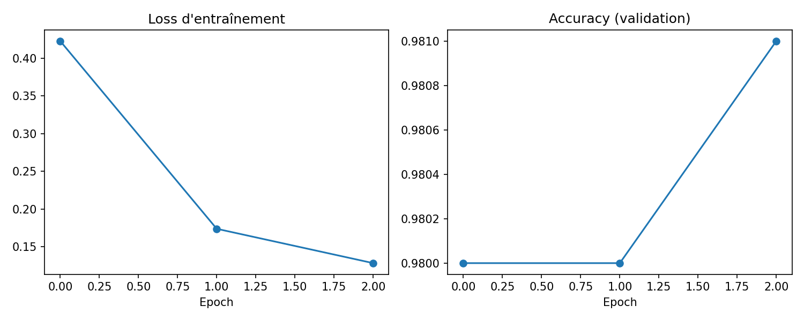

**Matrice de confusion** 

**Exemples de détections** (vert : boîte réelle, rouge pointillé : meilleure détection).
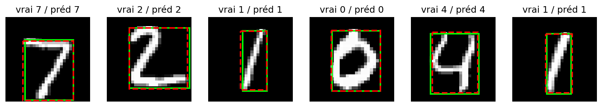

**Analyse**

- **Convergence** : La loss d'entraînement diminue nettement (0.4229 → 0.1283) et l'IoU de
  validation progresse (0.879 → 0.926) : le modèle localise de mieux en mieux le chiffre.
  L'accuracy de validation reste proche de 98 % dès la première époque.
- **Un modèle encore sous-entraîné** : La loss baisse toujours à l'époque 3 : quelques époques
  supplémentaires amélioreraient probablement les résultats, mais le temps de calcul était limité.
- **Erreurs** : Sur 10 000 images de test, 182 sont mal classées. Les confusions les plus
  fréquentes concernent le chiffre 9 : 9 → 7 (21 cas), 9 → 5 (13 cas), puis 7 → 2 (11 cas).
  Ce sont des chiffres dont les tracés peuvent se ressembler.
- **Remarque sur la métrique** : Ici, l'accuracy mesure le pipeline complet (propositions,
  localisation, classification) et non la classification seule, ce qui rend la tâche plus dure
  que pour le CNN.

### 1.3 Comparaison CNN vs Faster R-CNN

| Critère | CNN | Faster R-CNN |
|---|---|---|
| Accuracy (test, 10 000 images) | **99.04 %** | 98.18 % |
| F1-score macro (test) | **99.03 %** | 98.17 % |
| Images mal classées | **96** | 182 |
| Loss (test) | 0.0289 (cross-entropy) | 0.1250 (totale) / 0.0583 (classifieur) |
| Temps d'entraînement | **22.6 s** | 395.4 s |
| Paramètres | **421 834** | 28 329 606 |
| Données d'entraînement | 54 000 images | 15 000 images |
| Époques | 10 | 3 |
| Sortie | classe | classe + boîte englobante (IoU moyen 0.924) |

**Précautions de lecture**

- Les deux loss ne sont pas comparables : la cross-entropy du CNN porte sur 10 classes, celle de
  Faster R-CNN additionne 4 termes. La loss du classifieur (0.0583) est la plus proche de la
  cross-entropy mais reste mesurée sur des propositions de régions et sur 2 000 images seulement.
- La comparaison n'est pas à armes égales : Faster R-CNN a vu 3,6 fois moins d'images et
  3 fois moins d'époques que le CNN (allègements imposés par le temps de calcul).
  Accuracy, F1 et temps restent des indicateurs directement lisibles.

**Conclusion**

- Le **CNN est meilleur sur toutes les métriques de classification** (+0.86 point d'accuracy,
  presque deux fois moins d'erreurs) tout en étant **environ 17 fois plus rapide** à entraîner
  et **67 fois plus petit**.
- Cela s'explique par le fait que MNIST est une tâche de classification : une seule image,
  un seul chiffre centré, sans besoin de localisation. Le CNN y est directement adapté, alors
  que Faster R-CNN dépense l'essentiel de sa capacité à proposer des régions et à régresser
  des boîtes.
- Faster R-CNN apporte une information que le CNN ne fournit pas (la position du chiffre,
  avec un IoU moyen de 0.924) et son accuracy de 98,18 % reste élevée malgré un entraînement
  réduit. Il serait pertinent pour des images contenant plusieurs objets ou des chiffres à
  localiser, pas pour MNIST seul.
  
### 1.4 Fine-tuning de VGG16 et AlexNet

**Principe :** Les deux modèles sont chargés avec leurs poids pré-entraînés sur ImageNet
(torchvision). Seule la dernière couche est remplacée (4096 → 10 classes au lieu de 1000),
puis **toutes les couches sont ré-entraînées** sur MNIST avec un faible learning rate.

**Adaptation des entrées :** Les images 28×28 en niveaux de gris sont agrandies à 64×64
(interpolation bilinéaire), répétées sur 3 canaux et normalisées avec les statistiques
ImageNet (moyenne [0.485, 0.456, 0.406], écart-type [0.229, 0.224, 0.225]).

**Hyperparamètres (identiques pour les deux modèles)**

| Paramètre | Valeur |
|---|---|
| Optimiseur | Adam, lr = 1e-4, weight decay 1e-4 |
| Perte | CrossEntropyLoss |
| Batch size | 64 |
| Époques | 3 |
| Précision mixte (AMP) | oui |
| Données | 15 000 images d'entraînement, 1 000 de validation, 10 000 de test |
| Matériel | GPU Tesla T4 (Kaggle) |

Les données d'entraînement sont les mêmes que pour Faster R-CNN (même découpage, graine 42).

**Suivi de l'entraînement**

| Modèle | Époque | Loss train | Loss val | Accuracy val | F1 val | Temps cumulé |
|---|---|---|---|---|---|---|
| AlexNet | 1 | 0.3103 | 0.0812 | 97.20 % | 97.15 % | 8 s |
| AlexNet | 2 | 0.0724 | 0.0548 | 98.30 % | 98.27 % | 16 s |
| AlexNet | 3 | 0.0433 | 0.0447 | 98.50 % | 98.52 % | 24 s |
| VGG16 | 1 | 0.2051 | 0.0828 | 97.90 % | 97.90 % | 27 s |
| VGG16 | 2 | 0.0489 | 0.0963 | 97.50 % | 97.54 % | 53 s |
| VGG16 | 3 | 0.0346 | 0.0830 | 98.70 % | 98.69 % | 78 s |

**Résultats sur le jeu de test (10 000 images)**

| Modèle | Accuracy | F1 (macro) | Loss | Temps | Paramètres | Images mal classées |
|---|---|---|---|---|---|---|
| AlexNet (FT) | 98.19 % | 98.19 % | 0.0646 | 24.4 s | 57 044 810 | 181 |
| VGG16 (FT) | 98.96 % | 98.96 % | 0.0425 | 77.7 s | 134 301 514 | 104 |

**Courbes et matrices de confusion**
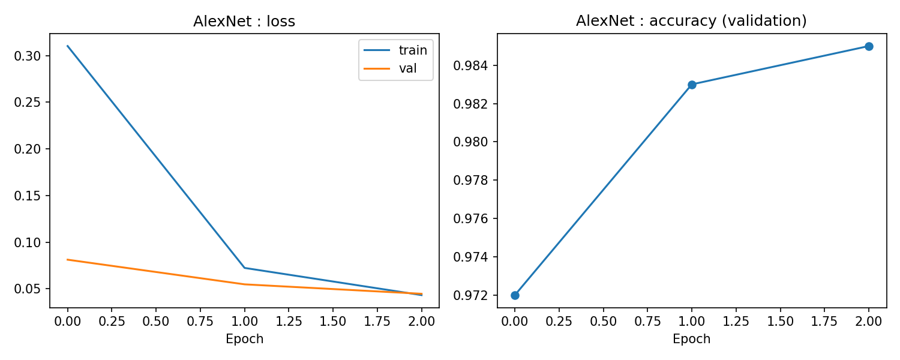 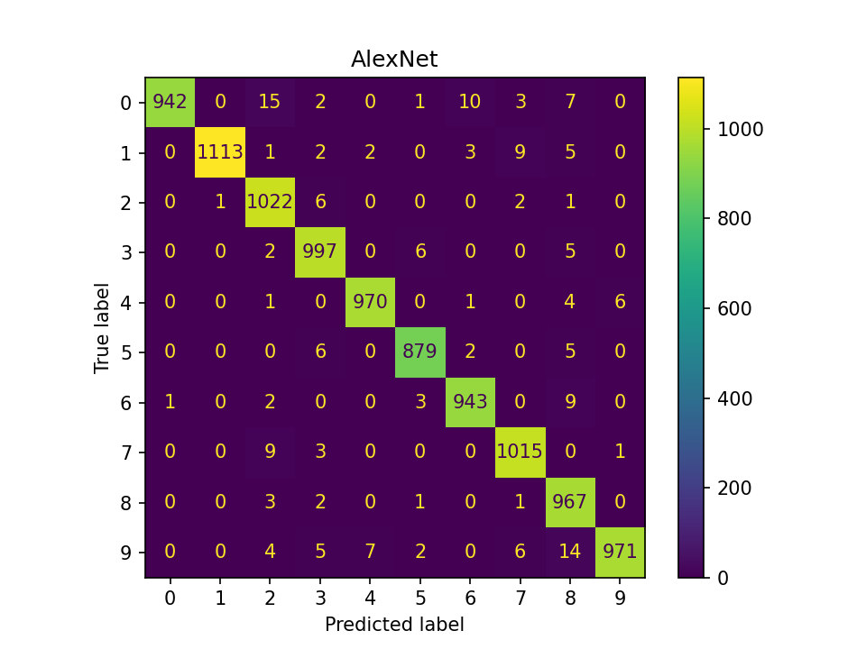
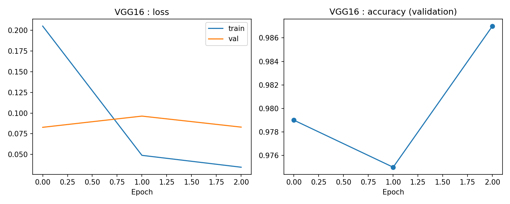 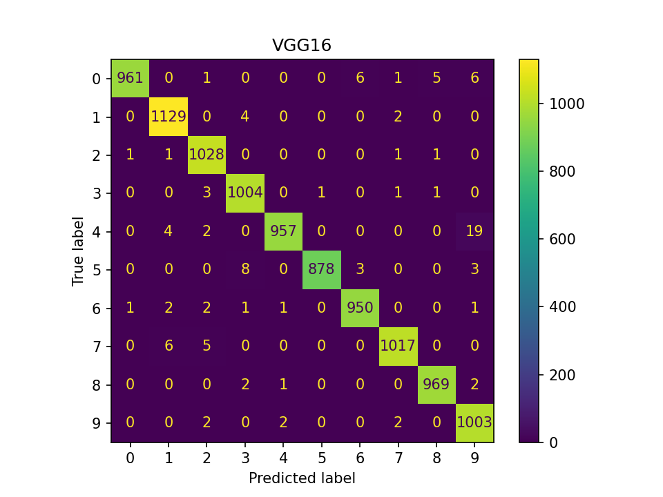

**Analyse**

- **Convergence rapide grâce au pré-entraînement** :  Dès la première époque, VGG16 atteint 97,9 %
  et AlexNet 97,2 % d'accuracy en validation, alors que le CNN from scratch partait de 98,0 %
  mais avec 54 000 images. Les filtres appris sur ImageNet (bords, textures) se transfèrent bien
  aux chiffres, même si ImageNet contient des photos en couleur et MNIST des chiffres noir et blanc.
- **VGG16 bien meilleur qu'AlexNet** :  (+0.77 point d'accuracy, 104 erreurs contre 181), au prix
  d'un temps d'entraînement 3,2 fois plus long et de 2,4 fois plus de paramètres. Sa profondeur
  (16 couches, filtres 3×3 empilés) lui donne une représentation plus riche qu'AlexNet (8 couches).
- **Erreurs**  : Pour AlexNet, les confusions principales sont 0 → 2 (15 cas), 9 → 8 (14 cas),
  0 → 6 (10 cas), 1 → 7 (9 cas), 7 → 2 (9 cas) et 6 → 8 (9 cas). Pour VGG16, la principale
  est 4 → 9 (19 cas), suivie de 5 → 3 (8 cas).
- **Stabilité** :  La validation de VGG16 est irrégulière (accuracy 97,9 % → 97,5 % → 98,7 %, loss
  0.0828 → 0.0963 → 0.0830). Les ensembles de validation ne comptant que 1 000 images, ces
  variations de quelques dixièmes de point sont à interpréter avec prudence. Le test sur
  10 000 images est plus fiable (AlexNet : 98,50 % en validation contre 98,19 % en test).
- **Limites**  : Une seule exécution (graine 42), 3 époques seulement, sans recherche d'hyperparamètres
  ni gel de couches.

### Comparaison finale de la partie 1

| Modèle | Accuracy | F1 (macro) | Loss | Temps | Paramètres | Données / époques |
|---|---|---|---|---|---|---|
| **CNN (from scratch)** | **99.04 %** | **99.03 %** | 0.0289 | 22.6 s | **421 834** | 54 000 / 10 |
| Faster R-CNN | 98.18 % | 98.17 % | 0.1250* | 395.4 s | 28 329 606 | 15 000 / 3 |
| AlexNet (fine-tuné) | 98.19 % | 98.19 % | 0.0646 | 24.4 s | 57 044 810 | 15 000 / 3 |
| VGG16 (fine-tuné) | 98.96 % | 98.96 % | 0.0425 | 77.7 s | 134 301 514 | 15 000 / 3 |

\*Somme de 4 termes (RPN et tête de détection), mesurée sur 2 000 images : non comparable
aux cross-entropies des autres modèles.

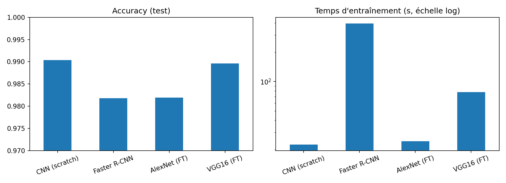

**Conclusion de la partie 1**

- **Classement par accuracy** : CNN (99,04 %) > VGG16 (98,96 %) > AlexNet (98,19 %) ≈ Faster R-CNN
  (98,18 %).
- **CNN et VGG16 sont équivalents en pratique** : l'écart est de 8 images sur 10 000. Pour une
  seule exécution, il est du même ordre que la variabilité statistique (environ ±0.1 point à
  99 % d'accuracy sur 10 000 images), donc on ne peut pas conclure que l'un est meilleur.
  En revanche, VGG16 atteint ce niveau en voyant **3,6 fois moins de données et 3 fois moins
  d'époques**, ce qui illustre l'intérêt du transfert d'apprentissage lorsque les données sont limitées.
- **Le coût est très différent**  : Le CNN from scratch obtient le meilleur résultat avec
  **318 fois moins de paramètres que VGG16** et 135 fois moins qu'AlexNet. Sur MNIST, jeu simple
  et propre, une petite architecture dédiée suffit : les grands modèles pré-entraînés n'apportent
  pas de gain de précision, mais seulement une convergence plus rapide en nombre d'époques.
- **Faster R-CNN est le moins adapté** à cette tâche : 17 fois plus lent que le CNN, avec une
  précision inférieure, car la détection d'objets (propositions de régions, boîtes) est inutile
  pour classer une image qui ne contient qu'un chiffre. Son seul avantage est la localisation
  (IoU moyen 0.924).
- **Recommandation** : Pour classifier MNIST : le CNN from scratch (meilleur compromis
  précision / coût). Si les données d'entraînement étaient rares, le fine-tuning de VGG16
  serait préférable. AlexNet est peu avantageux : il n'est que légèrement plus rapide que VGG16
  mais nettement moins précis.
- **Précaution** :  Les conditions d'entraînement diffèrent (le CNN a vu plus de données et
  d'époques) : la comparaison reflète donc des compromis pratiques, pas des capacités
  intrinsèques des architectures.

## Partie 2 : Vision Transformer (ViT)

### 2.1 ViT from scratch

**Principe** 

Le modèle suit l'architecture du tutoriel indiqué dans le sujet, écrite en PyTorch sans
bibliothèque de modèles : l'image est découpée en patchs, chaque patch est projeté linéairement en
un vecteur, un token de classe est ajouté, puis l'ensemble traverse des blocs d'encodeur Transformer.
La classe est prédite à partir du token de classe uniquement.

**Données**

Identiques à la partie 1 : MNIST lu depuis les fichiers IDX, découpage 54 000 train /
6 000 validation / 10 000 test (graine = 42), normalisation moyenne 0.1307 / écart-type 0.3081.
Les images restent en 28×28 à un seul canal, sans augmentation de données. Le jeu de données est
chargé en entier sur le GPU et les mini-batchs sont tirés directement depuis la mémoire GPU.

**Architecture**

| Élément | Détail | Sortie |
|---|---|---|
| Découpage en patchs | patchs de 4×4 pixels, sans chevauchement (7×7 = 49 patchs) | 49×16 |
| Projection linéaire | Linear 16→64 | 49×64 |
| Token de classe | vecteur appris de dimension 64, ajouté en tête de séquence | 50×64 |
| Encodage positionnel | sinusoïdal fixe (non appris), ajouté aux tokens | 50×64 |
| Encodeur (×4 blocs) | LayerNorm → attention multi-têtes (4 têtes, dimension 16 par tête) → connexion résiduelle ; LayerNorm → MLP (64→128→64, GELU) → connexion résiduelle | 50×64 |
| Sortie | LayerNorm sur le token de classe, puis Linear 64→10 | 10 |

Dropout de 0.1 dans l'attention et dans le MLP. Nombre de paramètres : **135 818**.

**Hyperparamètres**

| Paramètre | Valeur |
|---|---|
| Optimiseur | AdamW, lr = 1e-3, weight decay 0.05 |
| Planification | warm-up linéaire sur 200 itérations, puis décroissance en cosinus jusqu'à 0 |
| Fonction de perte | CrossEntropyLoss |
| Batch size | 128 |
| Époques | 10 |
| Matériel | GPU Tesla T4 (Kaggle) |

**Suivi de l'entraînement**

| Époque | Loss train | Loss val | Accuracy val | F1 val | Temps cumulé |
|---|---|---|---|---|---|
| 1 | 1.0528 | 0.2392 | 92.80 % | 92.70 % | 5 s |
| 2 | 0.2382 | 0.1497 | 95.42 % | 95.37 % | 9 s |
| 3 | 0.1625 | 0.1197 | 96.37 % | 96.33 % | 13 s |
| 4 | 0.1250 | 0.1036 | 96.65 % | 96.62 % | 17 s |
| 5 | 0.1017 | 0.0859 | 97.23 % | 97.21 % | 21 s |
| 6 | 0.0833 | 0.0813 | 97.52 % | 97.51 % | 25 s |
| 7 | 0.0691 | 0.0744 | 97.73 % | 97.71 % | 29 s |
| 8 | 0.0594 | 0.0709 | 97.92 % | 97.89 % | 33 s |
| 9 | 0.0509 | 0.0671 | 98.07 % | 98.05 % | 37 s |
| 10 | 0.0467 | 0.0667 | 98.08 % | 98.07 % | 42 s |

**Résultats sur le jeu de test (10 000 images)**

| Accuracy | F1-score (macro) | Loss | Temps d'entraînement | Paramètres | Images mal classées |
|---|---|---|---|---|---|
| 98.23 % | 98.22 % | 0.0567 | 41.6 s | 135 818 | 177 |

**Courbes d'apprentissage** 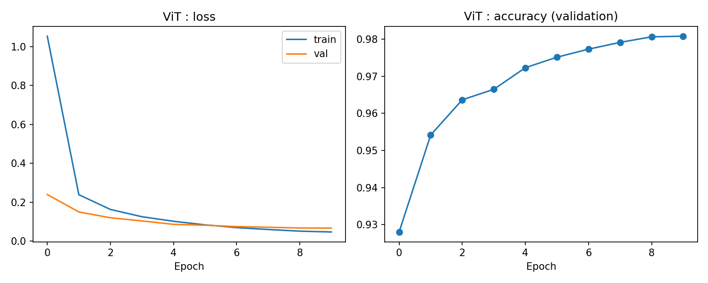

**Matrice de confusion** 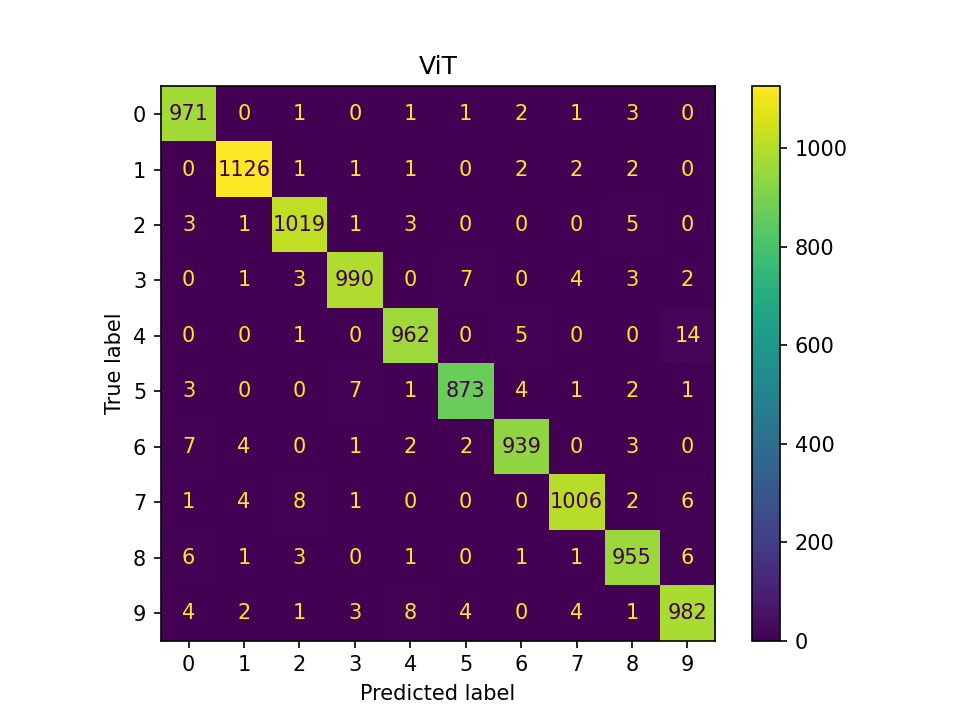

### 2.2 Interprétation des résultats

- **Convergence plus lente que le CNN** :  Le ViT démarre à 92,80 % d'accuracy en validation après la
  première époque, contre 98,03 % pour le CNN, et n'atteint 98 % qu'à l'époque 9. Les loss de
  train et de validation baissent à chaque époque.
- **Pas de surapprentissage, plutôt un modèle encore en progression** :  La loss de validation
  (0.0667) reste proche de la loss d'entraînement (0.0467) et diminue sans remonter, contrairement
  au CNN qui montrait un début de surapprentissage. Le plateau des dernières époques vient en partie
  de la décroissance du learning rate vers 0 (cosinus) : davantage d'époques seraient probablement
  utiles.
- **Erreurs** : Sur 10 000 images de test, 177 sont mal classées. Les confusions principales sont
  4 → 9 (14 cas), puis 7 → 2 (8 cas), 9 → 4 (8 cas), 3 → 5, 5 → 3 et 6 → 0 (7 cas chacune).
  On retrouve les mêmes paires que pour les modèles de la partie 1 (4 → 9 avec le CNN et VGG16,
  7 → 2 avec le CNN, AlexNet et Faster R-CNN) : ce sont des chiffres dont les tracés manuscrits se
  ressemblent, quelle que soit l'architecture.
- **Limites** :  Résultats issus d'une seule exécution (graine 42), sans augmentation de données ni
  recherche d'hyperparamètres (taille des patchs, profondeur, nombre de têtes, nombre d'époques).

### 2.3 Comparaison avec la partie 1

| Modèle | Accuracy | F1 (macro) | Loss | Temps | Paramètres | Images mal classées | Données / époques |
|---|---|---|---|---|---|---|---|
| **CNN (from scratch)** | **99.04 %** | **99.03 %** | 0.0289 | **22.6 s** | 421 834 | **96** | 54 000 / 10 |
| Faster R-CNN | 98.18 % | 98.17 % | 0.1250* | 395.4 s | 28 329 606 | 182 | 15 000 / 3 |
| AlexNet (fine-tuné) | 98.19 % | 98.19 % | 0.0646 | 24.4 s | 57 044 810 | 181 | 15 000 / 3 |
| VGG16 (fine-tuné) | 98.96 % | 98.96 % | 0.0425 | 77.7 s | 134 301 514 | 104 | 15 000 / 3 |
| **ViT (from scratch)** | 98.23 % | 98.22 % | 0.0567 | 41.6 s | **135 818** | 177 | 54 000 / 10 |

**Somme de 4 termes, mesurée sur 2 000 images** : non comparable aux cross-entropies des autres modèles.

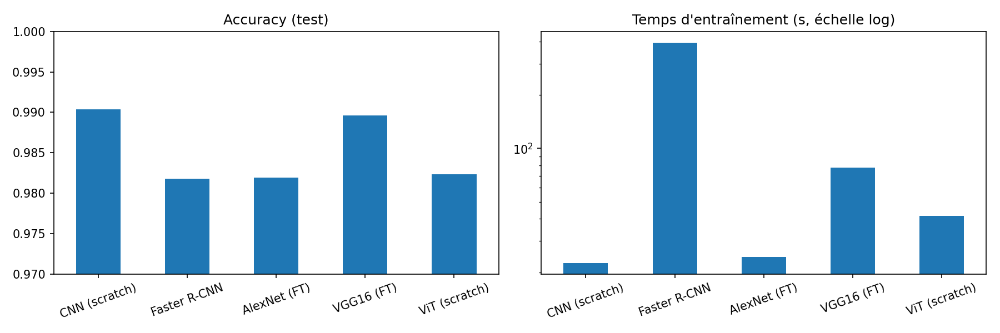

- **ViT contre CNN (comparaison la plus équitable)** :  Les deux sont entraînés from scratch, sur les
  mêmes 54 000 images et pendant 10 époques. Le CNN est meilleur : +0.81 point d'accuracy, 96 erreurs
  contre 177, et un entraînement environ 1,8 fois plus rapide. Cet écart dépasse largement la
  variabilité statistique d'une exécution (environ ±0.1 à ±0.15 point sur 10 000 images), il est
  donc significatif.
- **ViT contre AlexNet et Faster R-CNN** :  L'accuracy du ViT (98,23 %) est équivalente à celles
  d'AlexNet (98,19 %) et de Faster R-CNN (98,18 %) : l'écart de quelques images sur 10 000 est
  dans la marge de variabilité. Le ViT est en revanche **208 fois plus petit** que Faster R-CNN et
  **420 fois plus petit** qu'AlexNet, et il s'entraîne 9,5 fois plus vite que Faster R-CNN.
- **ViT contre VGG16** :  VGG16 fine-tuné reste meilleur (98,96 %, 104 erreurs) avec seulement
  15 000 images et 3 époques, mais il compte environ **989 fois plus de paramètres** et s'entraîne
  1,9 fois plus longtemps que le ViT.
- **Moins de paramètres ne veut pas dire plus rapide.** Le ViT est le plus petit modèle de tous
  (135 818 paramètres, soit 3,1 fois moins que le CNN), mais il est plus lent que le CNN. Le coût
  de l'attention dépend du nombre de tokens (50 par image) et non seulement du nombre de paramètres.

**Pourquoi le ViT fait moins bien que le CNN sur MNIST ?**

- Le CNN intègre dès sa conception des hypothèses utiles pour les images (pixels voisins liés,
  même filtre appliqué partout). Le ViT doit apprendre ces régularités à partir des données, ce qui
  demande en général plus de données et plus d'époques. La convergence plus lente observée va dans ce sens.
- Les images MNIST sont petites (28×28) et simples, ce qui favorise les convolutions locales ;
  l'attention globale du ViT n'apporte pas d'avantage sur des chiffres centrés.
- Le ViT a été entraîné 10 époques, sans augmentation de données, avec une configuration non optimisée.

## Comparaison globale et conclusion

**Classement par accuracy (test)** : CNN (99,04 %) > VGG16 (98,96 %) > ViT (98,23 %) ≈ AlexNet (98,19 %)
≈ Faster R-CNN (98,18 %).

- **Sur MNIST, une petite architecture convolutive dédiée suffit et gagne** : Le CNN from scratch
  (0,42 M de paramètres, 22,6 s) obtient la meilleure accuracy, devant le ViT, Faster R-CNN et AlexNet.
  Les modèles plus grands ou plus récents n'apportent pas de gain de précision sur ce jeu simple et propre.
- **Le fine-tuning de VGG16 est le seul concurrent du CNN**  : Il atteint 98,96 % avec 3,6 fois moins
  d'images et 3 fois moins d'époques, ce qui illustre l'intérêt du transfert d'apprentissage quand
  les données sont limitées, mais avec un coût en paramètres très élevé (134 M).
- **Le ViT from scratch est un bon compromis taille / précision, pas un gain de précision** : 
  Avec 135 818 paramètres, il atteint un niveau équivalent à AlexNet et à Faster R-CNN, mais reste
  derrière le CNN et VGG16, car il apprend sans les hypothèses propres aux convolutions.
- **Faster R-CNN reste le moins adapté** : le plus lent (395,4 s) pour une accuracy inférieure,
  la détection d'objets n'ayant pas d'utilité pour classer un chiffre unique.
- **Recommandation**
  
  Pour classifier MNIST : le CNN from scratch.

  Avec peu de données d'entraînement : le fine-tuning de VGG16.

  Le ViT deviendrait plus intéressant sur des images plus grandes et plus variées, avec davantage de données ou un pré-entraînement.
- **Précaution**
  
  Les conditions d'entraînement ne sont pas identiques pour tous les modèles(données, époques, from scratch ou pré-entraîné), et chaque résultat vient d'une seule   exécution : la comparaison reflète des compromis pratiques, pas des capacités intrinsèques des architectures.
  Seule la comparaison CNN / ViT est faite à     conditions égales.

## Synthèse personnelle

Ce lab m'a permis de prendre en main PyTorch de bout en bout : construire des modèles, les entraîner
sur GPU et les évaluer avec plusieurs métriques (accuracy, F1, loss, temps d'entraînement, nombre
de paramètres) plutôt qu'avec l'accuracy seule.

- J'ai compris comment adapter un modèle conçu pour une autre tâche : Faster R-CNN est un détecteur,
  et pour l'utiliser sur MNIST il a fallu générer des boîtes englobantes et définir comment en tirer
  une classe. J'ai aussi vu que ce type de modèle est inutile quand il suffit de classifier.
- J'ai pratiqué le transfert d'apprentissage avec AlexNet et VGG16 : adapter les entrées (taille,
  trois canaux, normalisation ImageNet), remplacer la dernière couche et ré-entraîner avec un faible
  learning rate. Le pré-entraînement accélère la convergence, surtout quand les données sont limitées.
- J'ai implémenté un Vision Transformer from scratch (découpage en patchs, token de classe, encodage
  positionnel, attention multi-têtes) et compris son fonctionnement. J'ai aussi constaté qu'il
  converge plus lentement que le CNN sur MNIST, ce qui montre l'importance des hypothèses intégrées
  dans l'architecture quand les données sont peu nombreuses ou simples.
- Surtout, j'ai appris à lire une comparaison avec prudence : les loss de modèles différents ne sont
  pas toujours comparables, des conditions d'entraînement différentes biaisent les conclusions, et
  un écart de quelques images sur 10 000 reste dans la variabilité d'une seule exécution.
- Enfin, le modèle le plus gros ou le plus récent n'est pas forcément le meilleur : sur une tâche
  simple comme MNIST, le CNN le plus modeste offre le meilleur rapport précision / coût.

#
**Université Abdelmalek Essaadi – FST Tanger – Cycle LSI**

**Module :** Deep Learning et Applications – Pr. El Aachak Lotfi

**Réalisé par :** Andriamasy Lorraine Agnès RAHELIARISOA
